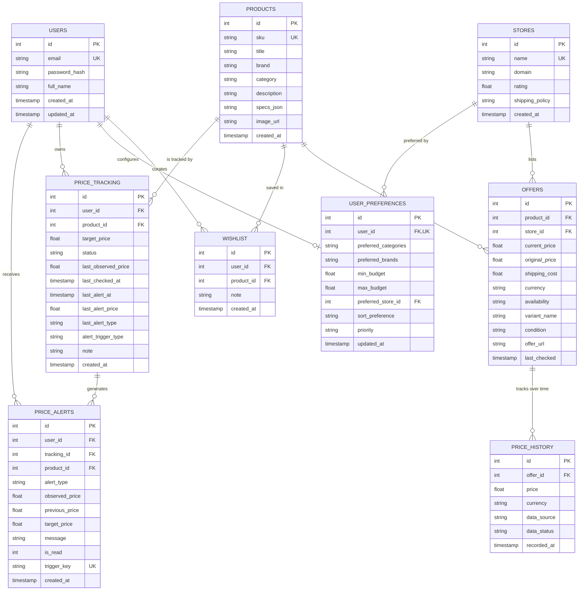

# PriceWise AI 🏷️

> **Academic Project:** Product Price Comparison Website with a distinctive **Real Deal Detector™** that evaluates current prices against recorded historical price data.
>
> **Tagline:** *Shop smarter. Save strategically.*

[](https://www.python.org/)
[](https://streamlit.io/)
[](https://www.sqlite.org/)
[]()
[]()
[]()

---

## 📌 Executive Summary

Modern ecommerce platforms often employ pricing volatility and artificial price inflation prior to sales events (such as inflating original list prices to exaggerate perceived markdown percentages).

**PriceWise AI** is designed not as a generic storefront clone, but as a **Shopping Intelligence Dashboard**. It aggregates multi-store pricing, factors in shipping and retailer trust, evaluates prices through its **Real Deal Detector™**, provides transparent product guidance with its **Smart Purchase Advisor**, tracks price drops, delivers **User Accounts, Wishlist & Personalization** (Phase 7), and reaches full academic maturity with **Final Testing, UI Polish & Academic Readiness** (Phase 8).

> **Disclaimer:** In accordance with academic prototype standards, all product records, retailer names (e.g., *TechMart Demo*, *ElectroHub Demo*), and price histories are curated sample data for evaluation purposes and clearly labeled as **DEMO DATA**.

---

## 🚀 Key Features (Phases 1 through 8)

### 1. Final Testing, UI Polish & Academic Project Readiness (Phase 8)
- **10 End-to-End Integration Scenarios**:
  - Full user registration lifecycle, wishlist curation, shopping note modification, and deletion.
  - Shopping preferences influence Smart Advisor recommendations with strict budget envelope enforcement.
  - Multi-store comparison to price tracking conversion with target threshold alerts.
  - Deterministic alert evaluation on target achievement and meaningful price drop ($\ge \$1.00 \land \ge 1\%$).
  - Duplicate notification prevention via tracking memory and database trigger-key idempotency.
  - Clean session transitions between multiple authenticated user accounts.
  - Strict tenant data isolation preventing cross-user reading, modifying, or alert leakage.
  - Non-destructive database migrations with foreign key validation across legacy tables.
  - Graceful resilience against empty catalogs, missing price history, and unknown specifications.
  - SQL injection resilience via parameterized queries and rigorous input validation.
- **UI Polish & Visual Hierarchy**:
  - Consistent modern dark-mode aesthetic with styled card borders, metric badges, and clear button iconography.
  - Enhanced product images with `object-fit: contain` and clean SVG fallback data URIs on network load error.
  - Dedicated **⚡ Quick Fill Demo Login** button in the sidebar for effortless viva demonstrations.
- **Comprehensive Academic Viva Guide**:
  - Full 15-step demonstration walkthrough in [`docs/DEMO_GUIDE.md`](docs/DEMO_GUIDE.md) with examiner Q&A cheat sheet.

### 2. User Accounts, Wishlist & Personalization (Phase 7)
- **Secure Authentication & Credential Architecture**:
  - Salted `PBKDF2-HMAC-SHA256` password hashing with 260,000 iterations and 16 bytes of cryptographically secure random salt (`secrets.token_bytes(16)`).
  - Constant-time verification with `secrets.compare_digest` to prevent timing attacks; passwords are never stored in plaintext.
  - RFC-compliant, case-insensitive email normalization and format validation.
  - Guest vs. Authenticated session state management in Streamlit with instant sign-in, registration, profile updates, and logout.
- **Account Ownership & Multi-Tenant Data Isolation**:
  - `price_tracking` and `price_alerts` tables include `user_id` foreign keys linking records to individual member accounts.
  - Non-destructive migration preserving existing legacy guest tracking records (`user_id IS NULL`).
  - Composite `UNIQUE(user_id, product_id)` constraint allowing different users to monitor identical products with distinct target thresholds.
  - Service-level authorization enforcement verifying caller identity before permitting update, pause, resume, or deletion of tracking records.
- **Persistent Personal Wishlist**:
  - Dedicated `wishlist` relational table supporting saved items with custom user notes (`note`), creation timestamps, and live lowest offer prices.
  - Direct integration with price tracking: shows live tracking status pills on wishlist cards.
  - Fast actions: Compare Stores, Setup Price Alert, Edit Shopping Note, and Remove from Wishlist.
  - Convenient "💖 Save to Wishlist" and "🤍 Add to Wishlist" action buttons across catalog cards and the comparison view.
- **Shopping Preferences & Adaptive Recommendation Scoring**:
  - `user_preferences` table storing preferred categories (JSON), preferred brands (JSON), min/max budget envelopes, preferred retailer, default sort, and optimization priority (`balanced`, `lowest_price`, `best_deal`).
  - **Explainable Personalization**: Preference synergies dynamically boost suitability scores and generate human-readable explanation tags (*"Matches your saved brand preference for Apple"*, *"Available at your preferred retailer Best Buy Demo"*).
  - **Hard Constraints Preserved**: User preferences *never* bypass hard constraints (budget ceilings, essential specs, in-stock availability). Items exceeding limits are safely routed to *Closest Alternatives*.

### 2. Persistent Price Tracking & Alerts Engine (Phase 6)
- **Persistent Product Watchlist**:
  - Add products directly to the **Price Tracker** (`price_tracking` table in SQLite) with personalized target prices, custom user notes, and monitoring trigger rules.
  - Track current price vs. target price in real time, displaying exact dollar savings and percentage distance to target.
  - Interactive status controls: **Pause** (temporarily silence alerts), **Resume** (re-enable evaluation), **Edit Target Price**, and **Remove Tracking**.
- **Deterministic Alert Rules & Thresholds**:
  - **🎯 Target Price Reached**: Triggers when the lowest available in-stock offer drops to or below the shopper's target price ($P_{curr} \le P_{target}$).
  - **📉 Meaningful Price Drop**: Triggers when an offer drops by at least **$1.00** AND at least **1.0%** relative to the previous observation ($\Delta P_{drop} \ge 1.00 \land \Delta P_{drop} / P_{prev} \ge 0.01$), filtering out fractional cent noise.
  - **Stock Availability Safeguard**: Offers marked *Out of Stock*, *Unavailable*, or *Discontinued* are excluded from triggering alerts.
- **Robust Duplicate Alert Prevention**:
  - **Tracking Record Memory**: Records `last_alert_price` and `last_alert_type` to prevent repeat notifications on unchanged prices across page reloads.
  - **Database-Level Idempotency**: Each notification generates a deterministic unique trigger key (e.g. `<track_id>:target_reached:<price>`) enforced by a `UNIQUE(trigger_key)` database constraint.
  - **Subsequent Shift Re-Arming**: Subsequent price fluctuations generate distinct trigger keys and issue fresh notifications.
- **In-App Alerts Inbox & Notification Center**:
  - Persistent notification inbox (`price_alerts` table in SQLite) with unread count badge.
  - Filter by unread alerts or view full notification history.
  - Actions to **Mark as Read** individually or **Mark All as Read** in batch.
  - Interactive Altair price trend chart for tracked items featuring a dashed red reference line for the user's target price.
  - Shortcut "🔔 Track this Product" buttons integrated directly into the Multi-Store Price Comparison view.

### 3. Smart Purchase Advisor & Recommendation Engine (Phase 5)
- **Deterministic 3-Tier Recommendation Categories**:
  - **🌟 BEST OVERALL**: Highest composite Recommendation Score ($R_{score}$) combining suitability, hardware specifications, and price-to-performance.
  - **💰 BEST BUDGET**: Lowest total checkout cost option that satisfies all the user's hard requirements and maximizes remaining budget.
  - **🏷️ BEST CURRENT DEAL**: Candidate with the highest verified Real Deal Score ($\ge 65$, `GOOD DEAL` or `EXCELLENT DEAL`). *A product is never labeled the best deal solely because it has the lowest nominal price.*
- **Explainable Recommendation Score ($R_{score} \in [0, 100]$)**:
  $$R_{score} = 0.40 \times S_{usecase} + 0.30 \times S_{spec} + 0.20 \times S_{budget} + 0.10 \times S_{brand}$$
  - Strictly separated from the Real Deal Score ($S_{deal}$); suitability for the user is not conflated with price attractiveness.
- **Workflow & Use-Case Matching**:
  - Specialized scoring for **Studying**, **Programming**, **Gaming**, **Photography**, **Office Work**, and **Everyday Use**.
- **Missing Specification Safeguards**:
  - Treats missing specs as *unknown* rather than assuming compliance. Products lacking required specs are barred from satisfying hard requirements and flagged with explicit missing-spec alerts.
- **Closest Alternatives Fallback**:
  - When no products satisfy all hard constraints, the advisor explains why and displays near-matches with exact budget overrun amounts or missing specs highlighted.

### 4. Complete Real Deal Detector™ & Explainable Scoring (Phase 4)
- **Deterministic 4-Tier Deal Scoring System (0–100)**:
  - **80 – 100: EXCELLENT DEAL** — At or near historical minimum, substantially below historical mean (`is_good_value = True`).
  - **65 – 79: GOOD DEAL** — Noticeably below typical pricing (`is_good_value = True`).
  - **45 – 64: FAIR PRICE** — Within standard pricing range (`is_good_value = False`).
  - **0 – 44: POOR DEAL** — Overpriced or inflated relative to records (`is_good_value = False`).
- **Mathematical Scoring Formula**:
  $$\text{Deal Score} = \text{clamp}\left(0.60 \times S_{range} + 0.40 \times S_{avg}, 0, 100\right)$$
  - *Range component ($S_{range}$)*: $100 \times \left(1 - \frac{P_{curr} - P_{min}}{P_{max} - P_{min}}\right)$
  - *Average component ($S_{avg}$)*: $50 + 50 \times \left(\frac{\mu_{hist} - P_{curr}}{\mu_{hist} \times 0.20}\right)$
  - *All-time low guarantee*: Current price matching or beating historical minimum is awarded $\ge 85$.
  - *Suspicious discount penalty*: Score clamped to $\le 40$ upon detecting unverified reference marks.
- **Honest Handling of Insufficient Data**:
  - Requires at least 3 timestamped observations spanning 7+ days (or 5+ total).
  - When insufficient records exist, the score is strictly **withheld** (`deal_score = None`) and displays **INSUFFICIENT DATA** with an explicit statement of missing criteria.
- **Variant & Currency Isolation**: Strictly isolates offers and historical points by canonical variant (e.g., 128GB vs 256GB) and currency (USD vs EUR) to prevent statistical skew.
- **Value Verification Indicator**: Real-time evaluation pill (`✓ GOOD VALUE`, `● REGULAR VALUE`, or `INSUFFICIENT DATA`).

### 5. Suspicious Advertised Discount Detection
- Transparently analyzes seller advertised discounts without making accusations of fraud:
  - **Promotional Price Exceeds Average**: Warns when an advertised "sale" price is actually higher than the recorded historical average.
  - **Unverified Reference Price**: Flags when an advertised MSRP is more than 15% above the highest recorded historical price.

### 6. Persistent Historical Price Tracking (Phase 3)
- **Timestamped Observation Ledger**: Uses SQLite `price_history` to track immutable price points with currency, data source (`demo_seed`, `manual_check`, etc.), data status, and ISO timestamps.
- **Deduplication Engine**: `record_price_observation()` prevents accidental duplicate records when the same price is captured within a configurable observation window (default: 1 hour), while capturing genuine price fluctuations.
- **Additive Schema Migrations**: Safe, non-destructive database evolution (`migrate_db()`) that checks and alters columns (`variant_name`, `condition`, `currency`, `data_source`, `data_status`) with backups before modification.

### 7. Interactive Historical Price Chart (Altair)
- Visualizes time-series price trails by store across **Last 30 Days (`30d`)**, **Last 90 Days (`90d`)**, and **All-Time History (`all`)**.
- Displays horizontal benchmark lines for **Historical Minimum** (green dotted) and **Historical Average** (gray dashed).
- Interactive tooltips with store, date, price, and DEMO DATA labeling.

### 8. Multi-Store Price Comparison & Functional Discovery (Phases 1 & 2)
- **Case-Insensitive Multi-Term Search**: Searches across title, brand, SKU, description, and specifications regardless of word order.
- **Dynamic Category & Brand Filtering**: Brand list updates dynamically based on the selected category.
- **In-Stock Filtering & Price Constraints**: Filters out completely unavailable items.
- **Strict Variant Matching**: Validates product IDs, positive pricing, and variant specs, rejecting uncertain or contradictory offers.
- **Lowest Available Offer Highlighting**: Distinguishes between out-of-stock list prices and genuine in-stock deals, highlighting the best total checkout cost.

---

## 🗂️ Project Structure

```
pricewise-ai/
├── README.md                  # Project documentation & instructions
├── requirements.txt           # Python dependencies
├── pytest.ini                 # Pytest configuration
├── .gitignore                 # Git ignore rules
├── app.py                     # Streamlit main entrypoint & session state
├── docs/
│   └── DEMO_GUIDE.md          # 15-step college viva presentation guide & examiner Q&A
├── data/
│   ├── schema.sql             # Relational SQLite database schema
│   ├── pricewise.db           # SQLite database (auto-created on first run)
│   └── pricewise.db.backup_phase2 # Database backup prior to Phase 3 migrations
├── src/
│   ├── __init__.py
│   ├── config.py              # Configuration constants & metadata
│   ├── database/
│   │   ├── __init__.py
│   │   ├── connection.py      # SQLite connection manager & safe migrations
│   │   ├── models.py          # Data models (Product, Offer, Store, User, WishlistItem, UserPreferences)
│   │   ├── price_history_service.py # Observation recording & deduplication
│   │   └── seed.py            # Academic demo data seed script (90-day history)
│   ├── analysis/
│   │   ├── __init__.py
│   │   └── deal_detector.py   # Real Deal Detector™ shopping intelligence engine
│   ├── services/
│   │   ├── __init__.py
│   │   ├── auth_service.py           # Phase 7 PBKDF2 authentication & user accounts
│   │   ├── wishlist_service.py       # Phase 7 persistent user wishlist service
│   │   ├── preference_service.py     # Phase 7 shopping preferences & personalization
│   │   ├── product_service.py        # Product queries, filters, and searches
│   │   ├── comparison_service.py     # Multi-store ranking & time-series formatting
│   │   ├── recommendation_service.py # Smart Purchase Advisor recommendation engine
│   │   └── price_tracking_service.py # Phase 6 & 7 watchlist & alert evaluation engine
│   └── ui/
│       ├── __init__.py
│       ├── styles.py          # Custom CSS for dashboard hierarchy & cards
│       ├── components.py      # Reusable UI widgets (cards, table, meters, chart, wishlist actions)
│       └── views/
│           ├── __init__.py
│           ├── home_view.py       # Catalog browsing & intelligence stats bar
│           ├── advisor_view.py    # Smart Purchase Advisor & personalized recommendations
│           ├── comparison_view.py # Detailed comparison, deal analysis, quick track & wishlist
│           ├── wishlist_view.py   # Phase 7 personal wishlist & account dashboard
│           ├── tracking_view.py   # Price Tracker, target price monitor, alerts inbox
│           ├── preferences_view.py# Phase 7 shopping preferences & personalization
│           └── about_view.py      # Academic methodology & architecture info
└── tests/
    ├── __init__.py
    ├── test_comparison.py     # Tests for lowest price & shipping calculations
    ├── test_database.py       # Tests for DB schema, queries, and seeding
    ├── test_deal_detector.py  # Tests for deal score & fake discount detection
    ├── test_phase2_search_and_comparison.py # Tests for search, filters, variant matching
    ├── test_phase3_historical_and_deal_detector.py # Tests for persistent history, windows, thresholds
    ├── test_phase4_complete_deal_detector.py # Tests for Phase 4 Real Deal Detector (12 scenarios)
    ├── test_phase5_smart_advisor.py # Tests for Phase 5 Smart Purchase Advisor (11 scenarios)
    ├── test_phase6_price_tracking.py # Tests for Phase 6 Price Tracking & Alerts (22 scenarios)
    ├── test_phase7_auth.py    # Tests for Phase 7 PBKDF2 auth & password validation (8 scenarios)
    ├── test_phase7_wishlist.py# Tests for Phase 7 persistent wishlist & notes (7 scenarios)
    ├── test_phase7_preferences.py # Tests for Phase 7 user preferences validation & defaults (6 scenarios)
    ├── test_phase7_personalization.py # Tests for Phase 7 personalized advisor scoring (13 scenarios)
    └── test_phase8_integration.py # Tests for Phase 8 End-to-End Integration & Resilience (10 scenarios)
```

---

## ⚙️ Installation & Setup

### 1. Prerequisites
- Python 3.10, 3.11, or 3.12 (Python 3.12 recommended).
- Git (optional).

### 2. Create Virtual Environment
Using standard Python `venv`:
```bash
python -m venv .venv

# On Windows (PowerShell):
.\.venv\Scripts\Activate.ps1

# On macOS/Linux:
source .venv/bin/activate
```
*(Or with `uv`: `uv venv --python 3.12 && .\.venv\Scripts\activate`)*

### 3. Install Dependencies
```bash
pip install -r requirements.txt
```

### 4. Initialize and Seed the Database
```bash
python -m src.database.seed
```
This initializes `data/pricewise.db` and populates 11 products across 6 categories, 5 demo retailers, 90 days of timestamped price observation trails, and initializes the demo user account.

---

## 🖥️ Running the Application

Launch the Streamlit web dashboard:
```bash
streamlit run app.py
```

Open your browser at:
```
http://localhost:8501
```

### 🔑 Demo Credentials for Viva / Presentation
| Credential | Value |
|:---|:---|
| **Email** | `demo@pricewise.ai` |
| **Password** | Set via `PRICEWISE_DEMO_USER_PASSWORD` env var |
| **One-Click Action** | Click **⚡ Quick Fill Demo Login** in the sidebar |
| **Step-by-Step Viva Guide** | [`docs/DEMO_GUIDE.md`](docs/DEMO_GUIDE.md) |

---

## 🧪 Running Unit Tests

Execute the automated test suite with pytest:
```bash
pytest -v
```

### Test Suite Summary (135 tests across 13 modules — 100% Passing):
- `tests/test_phase8_integration.py` (10 tests): Validates 10 complete cross-module integration scenarios including registration lifecycle, wishlist management, personalized Smart Advisor recommendations, multi-store comparison to tracking pipeline, alert triggering & evaluation, duplicate alert prevention, user session switching, cross-tenant isolation, legacy schema migration, and SQL injection & malformed input resilience.
- `tests/test_phase7_auth.py` (8 tests): Validates salted PBKDF2 hashing, constant-time verification, password update, email validation & normalization, and duplicate account rejection.
- `tests/test_phase7_wishlist.py` (7 tests): Validates adding to wishlist, removing items, notes update, item count retrieval, lowest offer joining, duplicate avoidance, and multi-user wishlist isolation.
- `tests/test_phase7_preferences.py` (7 tests): Validates preference storage, defaults initialization, category & brand arrays, budget envelope limits, reset-to-defaults, store selection, and get_available_stores ordering.
- `tests/test_phase7_personalization.py` (13 tests): Validates personalized brand score boost, category affinity priority, retailer preference explanation, user-level tracking isolation, multi-user target collision prevention, cross-tenant update rejection, and hard budget compliance under personalization.
- `tests/test_phase6_price_tracking.py` (22 tests): Validates tracking record lifecycle, target price validations, Target Price Reached deterministic alerts, Meaningful Price Drop alerts, insignificant fluctuation suppression, paused tracker alert silencing, out-of-stock offer exclusions, duplicate alert prevention, and alert inbox management.
- `tests/test_phase5_smart_advisor.py` (11 tests): Validates budget compliance, total cost with shipping, category and use-case matching, missing specifications handling, recommendation ranking order, and closest alternatives generation.
- `tests/test_phase4_complete_deal_detector.py` (12 tests): Validates historical average calculation, min/max calculations, 30d/90d window filtering, 4-tier deal classifications, insufficient data score withholding, and suspicious advertised discount analysis.
- `tests/test_phase3_historical_and_deal_detector.py` (12 tests): Validates persistent observations, deduplication interval, 30d/90d real timestamp window filtering, and Deal Score threshold tiers.
- `tests/test_phase2_search_and_comparison.py` (23 tests): Validates case-insensitive tokenized search, SKU/model matching, dynamic brand filters, in-stock filtering, and strict variant validation.
- `tests/test_comparison.py` (3 tests): Verifies lowest price identification, effective total cost with shipping, and arbitrage spread calculation.
- `tests/test_database.py` (3 tests): Tests database initialization, seed data integrity, category extraction, and keyword filtering.
- `tests/test_deal_detector.py` (4 tests): Validates deal score normalization, all-time low recognition, and fake discount alerts.

---

## 📊 Database Schema Overview



---

## ⚖️ Scoring Methodology & Demo Data Limitations

1. **Curated Demo Dataset**: In compliance with academic evaluation standards, all products, stores (*TechMart Demo*, *ElectroHub Demo*, etc.), and historical price observations are simulated data.
2. **Deterministic Rules vs. Market Truth**: Deal Scores (0–100) are rule-based heuristics that evaluate an offer relative to available recorded data. They do not constitute guaranteed investment or purchasing advice.
3. **Data Sufficiency Rule**: Reliable scoring requires a minimum evidence threshold (at least 3 observations over 7+ days). For recently added products or single-observation items, scores are honestly withheld with the **INSUFFICIENT HISTORY** verdict.
4. **Suspicious Discount Warnings**: Alerts for discrepancies between reference MSRP and historical pricing represent analytical flags regarding price inflation; they are not legal findings of fraudulent activity.
5. **Multi-User Isolation**: User accounts, wishlists, and personalized target monitors are maintained in local SQLite storage. All personal data isolation is strictly validated via automated unit test assertions.
